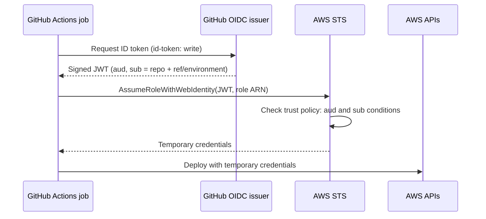

# github-actions-oidc-aws

Keyless deployments from GitHub Actions to AWS. Two small Terraform modules create the GitHub OIDC provider and least-privilege IAM roles, so workflows get short-lived credentials and no long-lived access keys are stored in GitHub secrets.

Placeholder names and account IDs only; replace them with your own.

## Why OIDC instead of access keys

| Static IAM user keys | OIDC federation |
|----------------------|-----------------|
| Long-lived secret stored in GitHub | No stored secret |
| Manual rotation, easy to leak | Credentials expire in about an hour |
| Same key usable from anywhere | Role is bound to one repo, ref or environment |
| Hard to audit who used it | Every session is tied to a workflow run in CloudTrail |

## How it works



## Modules

| Module | Purpose |
|--------|---------|
| `modules/github-oidc-provider` | Creates the OIDC identity provider (once per account) |
| `modules/github-oidc-role` | Creates a role trusted only for specific repo refs, environments, or pull requests |

## Usage

```hcl
module "provider" {
  source = "./modules/github-oidc-provider"
}

module "plan_role" {
  source             = "./modules/github-oidc-role"
  role_name          = "gha-terraform-plan"
  oidc_provider_arn  = module.provider.arn
  github_org         = "your-github-username"
  github_repo        = "your-infra-repo"
  allow_pull_request = true
  allowed_refs       = ["refs/heads/main"]
  policy_arns        = ["arn:aws:iam::aws:policy/ReadOnlyAccess"]
}
```

See `examples/basic` for a plan role plus an apply role gated by a GitHub Environment, and `examples/workflows/terraform.yml` for the matching workflow.

## Security design

- **Exact repo match**: wildcards in org or repo names are rejected by variable validation. A pattern like `repo:org/*` would let any repo in the org assume the role.
- **Split roles**: pull requests get a read-only plan role; only the `production` environment (with required reviewers) can assume the apply role.
- **Audience pinned** to `sts.amazonaws.com`.
- **Short sessions**: default 1 hour; lower it for sensitive roles.
- **Fails closed**: a role with no allowed refs, environments or PR access cannot be created.
- **Branch protection matters**: a role trusted for `refs/heads/main` is only as safe as who can push to `main`.

## Troubleshooting

| Symptom | Likely cause |
|---------|--------------|
| `Not authorized to perform sts:AssumeRoleWithWebIdentity` | The `sub` claim does not match. Using an environment changes `sub` to `...:environment:<name>`, and the ref is no longer included. |
| `Credentials could not be loaded` | Missing `permissions: id-token: write` in the workflow |
| Works on `main`, fails on PRs | `allow_pull_request` is false for that role |
| Role works then fails after repo rename | The trust policy still has the old repo name |

Subject matching is case-sensitive, so match the repository's exact casing.

## CI

Pull requests run `terraform fmt`, `validate` (through the example), TFLint and a Trivy config scan.

## License

MIT
